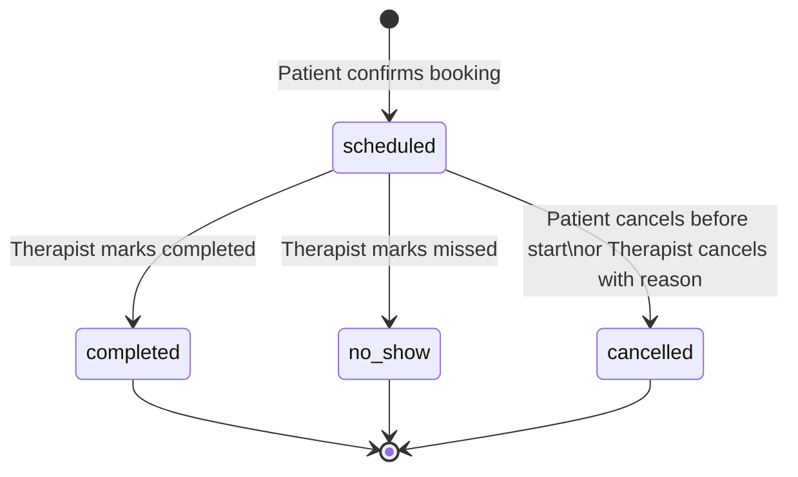

# Appointment Booking System

A full-stack appointment booking application where patients can hold and book slots with a therapist, including recurring appointments. Built with React + TypeScript (frontend), Node.js + Express + TypeScript (backend), and MySQL.

## Live Demo

- Frontend: https://appointment-booking-platform-eight.vercel.app
- Backend API: https://appointment-booking-platform-production.up.railway.app

## Demo Credentials

| Role      | Email               | Password     |
|-----------|---------------------|--------------|
| Patient   | patient@demo.com    | password123  |
| Patient 2 | patient2@demo.com   | password123  |
| Patient 3 | patient3@demo.com   | password123  |
| Patient 4 | patient4@demo.com   | password123  |
| Therapist | therapist@demo.com  | password123  |
| Therapist 2 | therapist2@demo.com | password123 |

## Features

- **Patient:** View derived slots, 1-minute holds, one-time/recurring bookings, cancel instance or series
- **Therapist:** View appointments, record outcome during session (with grace period if forgotten), edit schedule without affecting bookings
- **Recurring:** Daily, weekly, bi-weekly, monthly (6-month horizon)
- **Concurrency:** DB transactions, unique constraints, idempotency keys for multi-cluster safety

## How it works (quick guide)

All times use **`APP_TIMEZONE`** (default: `Asia/Kolkata`). Status labels in the UI are friendly; the API still uses snake_case values.

### Status labels

| API value (`status`) | Shown in UI        |
|----------------------|--------------------|
| `scheduled`          | Scheduled          |
| `completed`          | Completed          |
| `no_show`            | Missed Appointment |
| `cancelled`          | Cancelled          |

### Who can do what, and when

#### Patient

| When | Can cancel? | Notes |
|------|-------------|-------|
| Before appointment starts | Yes | Cancel button + reason (min 3 characters) |
| During or after session | No | Button hidden; API returns 403 |

Patients cannot mark completed, no-show, or change therapist-recorded status.

#### Therapist

| When | Can update status? | Options (one time only) |
|------|--------------------|-------------------------|
| Before `startAt` | No | UI: *"Available when the appointment starts"* |
| During session (`startAt` → `endAt`) | Yes | Completed · Missed Appointment · Cancelled |
| After session, within grace period | Yes | Same 3 options; UI warns *"Late update — please record status soon"* |
| After grace period ends | No | UI: *"Update period has ended"*; appointment stays `scheduled` |

**Grace period:** `STATUS_UPDATE_GRACE_HOURS` (default **24**) — hours after `endAt` the therapist may still record status once.

**Rules for therapist updates:**
- Only while status is still `scheduled` (cannot change after recording)
- **Cancelled** requires a reason (min 3 characters)
- **Missed Appointment** (`no_show`) allows optional notes

### Example walkthrough

**Scenario A — Happy path (one-time booking)**

1. **Patient** logs in → selects a therapist → picks an open slot.
2. Slot is **held for 1 minute** (countdown shown). Patient confirms booking.
3. Appointment is created with status **`scheduled`**.
4. At session time, **therapist** opens Appointments → clicks **Completed** → confirms.
5. Status becomes **`completed`**. Neither side can change it again.

**Scenario B — Patient cancels before the session**

1. Patient has a future `scheduled` appointment.
2. Patient clicks **Cancel** → enters reason → confirms.
3. Status becomes **`cancelled`**; reason appears in the Notes column for both dashboards.

**Scenario C — Therapist marks no-show**

1. Patient does not join during the session window.
2. Therapist clicks **Missed Appointment** → optionally adds notes → confirms.
3. Status becomes **`no_show`**; notes visible to patient and therapist.

**Scenario D — Therapist forgot to update during the session**

1. Session ends at 3:00 PM; therapist forgets to record status.
2. Until **3:00 PM the next day** (24h grace), therapist still sees action buttons with a late-update warning.
3. Therapist records **Completed** (or Missed / Cancelled). After that, status is final.

**Scenario E — Recurring series**

1. Patient books **weekly** recurring appointments (materialised 6 months ahead).
2. Patient can **cancel one instance** (single appointment) or **cancel the whole series** (future instances stop).

### Flow diagram



### API examples (status updates)

**Patient cancel** (only before `startAt`):

```http
DELETE /api/bookings/42
Content-Type: application/json

{ "reason": "Schedule conflict" }
```

**Therapist update** (during session or within grace period):

```http
PATCH /api/therapist/appointments/42/status
Content-Type: application/json

{ "status": "completed" }
```

```http
PATCH /api/therapist/appointments/42/status
Content-Type: application/json

{
  "status": "cancelled",
  "cancellationReason": "Therapist unavailable — rescheduling"
}
```

```http
PATCH /api/therapist/appointments/42/status
Content-Type: application/json

{
  "status": "no_show",
  "noShowNotes": "Patient did not join the call"
}
```

## Tech Stack

- Frontend: React 19, Vite, TypeScript, React Router
- Backend: Express, TypeScript, Prisma, JWT, Zod, Helmet, express-rate-limit
- Database: MySQL 8

## Local Setup

### Prerequisites

- Node.js 18+
- Docker (for MySQL) or local MySQL on port 3307

### 1. Start MySQL

```bash
docker compose up -d
```

MySQL runs on **port 3307** (to avoid conflict with local MySQL on 3306).

### 2. Backend

```bash
cd backend
cp .env.example .env
npm install
npx prisma db push
npm run db:seed
npm run dev
```

API: http://localhost:3001

### 3. Frontend

```bash
cd frontend
npm install
npm run dev
```

App: http://localhost:5173

## API Overview

| Method | Path | Role | Description |
|--------|------|------|-------------|
| POST | `/api/auth/login` | Public | Login |
| GET | `/api/auth/me` | Auth | Current user |
| GET | `/api/therapists` | Patient | List therapists |
| GET | `/api/therapists/:id/slots` | Patient | Available slots |
| POST | `/api/holds` | Patient | Hold slot (1 min) |
| GET | `/api/holds/me` | Patient | Active hold |
| DELETE | `/api/holds/me` | Patient | Release hold |
| POST | `/api/bookings` | Patient | Confirm booking (Idempotency-Key) |
| GET | `/api/bookings/me` | Patient | My appointments |
| DELETE | `/api/bookings/:id` | Patient | Cancel appointment |
| GET | `/api/series/me` | Patient | My recurring series |
| DELETE | `/api/series/:id` | Patient | Cancel series |
| GET | `/api/therapist/appointments` | Therapist | My appointments |
| PATCH | `/api/therapist/appointments/:id/status` | Therapist | Update status |
| GET | `/api/therapist/schedule` | Therapist | Get schedule |
| PUT | `/api/therapist/schedule` | Therapist | Update schedule |

## Architectural Challenges & Approach

### 1. Concurrency (multiple patients, 3 server clusters)

**Challenge:** Two patients holding or booking the same slot simultaneously.

**Approach:** MySQL transactions + unique constraint on `(therapist_id, start_at)` for holds. Idempotency keys on confirm prevent duplicate bookings across clusters. No in-memory locks.

### 2. Derived slots (not pre-seeded)

**Challenge:** Schedule is weekly template; slots must be computed per date range.

**Approach:** Generate candidate slots from `therapist_schedules`, filter out booked, held, and projected recurring conflicts.

### 3. Temporary holds (1 minute, refresh-safe)

**Challenge:** Hold must survive page refresh and block other patients.

**Approach:** Server-side `slot_holds` with `expires_at`. Frontend polls `GET /holds/me` and shows countdown from server time.

### 4. Recurring appointments

**Challenge:** Multiple frequencies, conflict detection, cancel instance vs series.

**Approach:** `recurring_series` master + materialised `appointments` for 6 months. Monthly uses last-day-of-month rule for short months.

### 5. Distributed idempotency

**Challenge:** Retries from any of 3 API clusters must not create duplicate bookings.

**Approach:** Client sends `Idempotency-Key` header; server stores key → response in `idempotency_keys` table.

## Deployment

### Backend (e.g. Render / Railway)

1. Provision MySQL (Railway, PlanetScale, or Render MySQL)
2. Set env:
   - `DATABASE_URL` — MySQL connection string
   - `JWT_SECRET` — long random string
   - `FRONTEND_URL` — frontend origin (CORS)
   - `APP_TIMEZONE` — e.g. `Asia/Kolkata` (slot times + display)
   - `STATUS_UPDATE_GRACE_HOURS` — optional, default `24`
   - `PORT` — usually set by host
3. Build: `npm run build && npx prisma db push && npm run db:seed`
4. Start: `npm start`

### Frontend (e.g. Vercel / Netlify)

1. Set `VITE_API_URL` to backend URL (no trailing slash)
2. Optional: `VITE_APP_TIMEZONE` — match backend `APP_TIMEZONE`
3. Build: `npm run build`
4. Deploy `dist/` (include `vercel.json` for SPA routing on Vercel)

## Quick start (all services)

```bash
docker compose up -d
cd backend && cp .env.example .env && npm install && npx prisma db push && npm run db:seed && npm run dev
cd frontend && npm install && npm run dev
```

## Project Structure

```
├── backend/          # Express + Prisma API
├── frontend/         # React + Vite UI
├── docs/             # Design documentation
├── docker-compose.yml
├── README.md
└── AI_USAGE.md
```